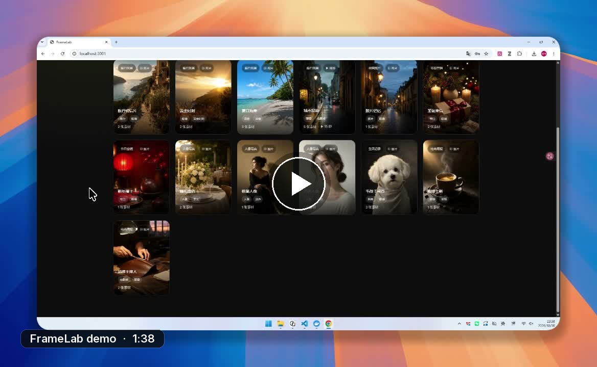
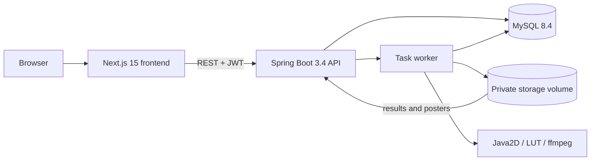
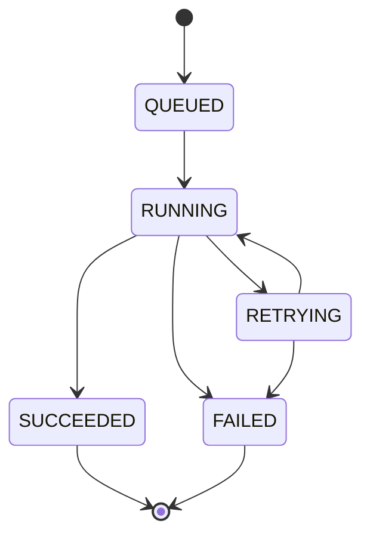

<div align="center">

[简体中文](README.md) ｜ **English**

# FrameLab

**Material production platform — from template to finished asset**

Browse templates · Upload photos · Async rendering · Review history


</div>

---

[](docs/assets/demo/framelab-demo.mp4)

<p align="center"><sub>Click the cover to watch the 1m38s demo: template filtering, photo upload, the three-stage task, result preview, and language switching</sub></p>

> **Accepted release** `v1.0.1-submission` ｜ [Clean-environment acceptance evidence](docs/evidence/m8-acceptance.md) ｜ [Visual evidence](docs/assets/visual) ｜ [Design docs](docs/README.md)

**Contents**　[Overview](#overview) · [Tech Stack](#tech-stack) · [Architecture](#architecture) · [Quick Start](#quick-start) · [Configuration](#configuration) · [Database](#database) · [API](#api) · [Security](#authentication--security) · [Testing & CI](#testing--ci) · [Operations](#deployment--operations) · [Limitations](#status--known-limitations) · [Checklist](#delivery-checklist)

## Overview

A dark, gallery-style material production site. Users browse templates, upload photos, and submit a three-stage asynchronous production job; they can keep browsing while it runs and review history and results afterwards. Image templates apply preset color grading and light portrait treatment; video templates render photos into a 15-second MP4.

| Capability | Details |
|---|---|
| Template library | 6 categories, 13 templates (12 image + 1 video), publicly browsable and filterable |
| Three-stage pipeline | `MATERIAL_CHECK → GENERATE → FINALIZE`, with per-stage progress and timing |
| Reliable execution | Idempotent submission, automatic retry with backoff, resume after restart |
| Result delivery | JPEG images, MP4 video (Range seeking supported) and poster frames |
| Account security | In-memory access tokens, refresh-token rotation, revoke-all-devices |
| Bilingual UI | Instant zh-CN / en-US switching, persisted after refresh |

## Tech Stack

| Layer | Choice | Actual version |
|---|---|---|
| Frontend | Next.js App Router / React / TypeScript | Next 15.5.28 / React 19.1.10 / TS 5.9.3 |
| Styling | Tailwind CSS 4 + CSS Variables + Radix Primitives | Tailwind 4.3.3 / Radix Dialog 1.3.1 |
| Frontend state | TanStack Query / Zustand / Zod | 5.105.0 / 5.0.16 / 4.6.7 |
| Frontend tests | Vitest + Testing Library + MSW | 5.0.5 / 16.3.3 / 3.0.3 |
| Backend | Java + Spring Boot | Java 21 / Spring Boot 3.4.13 |
| Security | Spring Security + Nimbus JOSE JWT | Security 6.4 / Nimbus 9.37.3 |
| Persistence | MyBatis | 3.0.5 |
| Database | MySQL / Flyway | 8.4 / Boot-managed |
| Image rendering | Java2D + `.cube` LUT | No extra runtime |
| Video rendering | ffmpeg / ffprobe | Local 8.1.2; installed via apt in the image |
| Runtime | Node / pnpm | Node 22 in containers, Node 24 / pnpm 12.16.1 locally |
| Delivery | Docker Compose / GitHub Actions | Compose v2+; workflow in `.github/workflows/ci.yml` |

## Architecture



- Access tokens live only in browser memory and are sent as `Authorization: Bearer`; the refresh token is an HttpOnly cookie.
- Assets and results live in a private volume; only template covers are served statically. Results cannot be guessed.
- Task state machine: `QUEUED → RUNNING → RETRYING / SUCCEEDED / FAILED`; terminal states are irreversible. After a step fails, later steps are marked `SKIPPED`.
- On restart, `RUNNING` tasks return to `QUEUED` (`resumeCount+1`); completed steps are not re-run and interrupted attempts are marked `INTERRUPTED`.



## Quick Start

Requirements: Docker Desktop / Engine with Compose v2. Video templates need ffmpeg, which is preinstalled in the image; local development requires `ffmpeg` / `ffprobe` (or disable `FRAMELAB_FFMPEG_ENABLED` in `.env`, in which case only video templates are unavailable).

```bash
cp .env.example .env
docker compose up --build
```

Startup order: MySQL healthy → backend Flyway migrations/seeds → backend healthy → frontend. Then open:

| Entry point | URL |
|---|---|
| Frontend | `http://localhost:3000` |
| API | `http://localhost:8080` |
| Health check | `http://localhost:8080/actuator/health` |

Seed accounts (demo only):

| Account | Password | Role |
|---|---|---|
| `demo@framelab.local` | `Demo1234!` | USER |
| `demo2@framelab.local` | `Demo1234!` | USER |
| `admin@framelab.local` | `Admin1234!` | ADMIN |

`.env` is a local file and is not committed. Production deployments must replace the JWT secret and database credentials, enable HTTPS, and set `FRAMELAB_COOKIE_SECURE=true`.

### Port conflicts

```bash
# Frontend host port (default 3000)
FRONTEND_PORT=3300

# MySQL host port (default 3306, bound to 127.0.0.1 only)
MYSQL_PORT=13306
```

Also update `FRAMELAB_CORS_ALLOWED_ORIGINS` to the actual frontend origin (e.g. `http://localhost:3300`). `NEXT_PUBLIC_BACKEND_URL` is inlined at build time, so run `docker compose build frontend` after changing it.

### Local development

```bash
# MySQL only
docker compose up -d mysql

# Backend (set MYSQL_HOST/MYSQL_PORT/MYSQL_USER/MYSQL_PASSWORD/FRAMELAB_JWT_SECRET from .env)
cd backend
./mvnw spring-boot:run

# Frontend
cd frontend
pnpm install --frozen-lockfile
NEXT_PUBLIC_BACKEND_URL=http://localhost:8080 pnpm dev
```

On Windows, set `JAVA_HOME` to JDK 21; tests run via `./mvnw verify`. Video templates also require a working `ffmpeg -version` locally (on Windows use `winget install Gyan.FFmpeg` or run the container image).

The default is `http://localhost:3000`. The `dev` profile allows `http://localhost:*` / `http://127.0.0.1:*`, so login works when Next.js switches ports automatically; the `docker` and production profiles accept only exact origins listed in `FRAMELAB_CORS_ALLOWED_ORIGINS`.

## Configuration

The root `.env.example` lists every variable:

<details>
<summary>Expand the environment variable table</summary>

| Variable | Default | Description |
|---|---|---|
| `MYSQL_ROOT_PASSWORD` | `framelab_root` | Compose initialization only; replace in production |
| `MYSQL_DATABASE` | `framelab` | Database name |
| `MYSQL_USER` / `MYSQL_PASSWORD` | `framelab` / `framelab_pass` | Application credentials; replace in production |
| `MYSQL_PORT` | `3306` | MySQL host port, bound to `127.0.0.1` only |
| `FRAMELAB_JWT_SECRET` | demo value | At least 32 bytes; must be replaced in the production profile |
| `FRAMELAB_CORS_ALLOWED_ORIGINS` | `http://localhost:3000` | Allowed frontend origins, comma-separated |
| `FRAMELAB_CORS_ALLOWED_ORIGIN_PATTERNS` | any localhost port in dev | Dev only; leave empty for docker/production |
| `FRAMELAB_COOKIE_SECURE` | `false` | Set to `true` behind production HTTPS |
| `FRAMELAB_REFRESH_ROTATION_ENABLED` | `true` | Refresh-token rotation; can be disabled for emergency rollback |
| `FRAMELAB_REFRESH_ROTATION_GRACE` | `30s` | Concurrency grace window for the previous token |
| `FRAMELAB_WORKER_THREADS` | `2` | Task worker concurrency |
| `FRAMELAB_WORKER_POLL_MS` | `500` | Claim polling interval |
| `FRAMELAB_RETRY_MAX_STEP_ATTEMPTS` | `3` | Per-step attempt limit snapshot |
| `FRAMELAB_RETRY_BACKOFF_BASE_SECONDS` | `2` | Backoff base; effective `min(base×2^(n-1), max)` |
| `FRAMELAB_RETRY_BACKOFF_MAX_SECONDS` | `30` | Backoff ceiling |
| `FRAMELAB_FFMPEG_ENABLED` | `true` | Video rendering switch; when off, video submissions return 503 |
| `FRAMELAB_FFMPEG_BINARY` / `FRAMELAB_FFMPEG_PROBE` | `ffmpeg` / `ffprobe` | Executable paths |
| `FRAMELAB_FFMPEG_TIMEOUT` | `180s` | Timeout per video render |
| `FRAMELAB_FFMPEG_MAX_CONCURRENT` | `1` | Concurrent renders per instance |
| `FRAMELAB_FFMPEG_MAX_OUTPUT_BYTES` | `209715200` | Output cap (200 MB) |
| `NEXT_PUBLIC_BACKEND_URL` | `http://localhost:8080` | API origin used by the browser, inlined at build time |
| `FRONTEND_PORT` | `3000` | Compose frontend host port |

</details>

The backend also supports `FRAMELAB_STORAGE_ROOT` (`/app/storage` in containers) and `SPRING_PROFILES_ACTIVE`.

## Database

- Migrations: `V1__schema.sql` (users, templates, assets, tasks, steps, attempts, simulation config), `V2__seed.sql` (demo accounts, categories, templates, simulation defaults), `V3__session_security.sql` (token version, refresh families, rotation chain), `V4__template_effects_video.sql` (template type/spec, task snapshots, video result fields), `V5__template_effect_seed.sql` (image effects and 2 new templates), `V6__video_template_seed.sql` (15-second video template).
- Final seed: 6 categories, 13 templates (12 image + 1 video), 3 demo accounts, one simulation config row.
- Flyway runs automatically at startup; no manual schema creation or SQL import needed.

Reset demo data (deletes tasks, assets, and results):

```bash
docker compose down -v
docker compose up --build
```

> `down -v` removes the `mysql-data` and `storage` volumes. Make sure nothing needs to be kept before running it.

## API

Full contract: [docs/04-api.md](docs/04-api.md).

| Method | Path | Description |
|---|---|---|
| POST | `/api/auth/login` | Email/password login; returns an access token and sets the refresh cookie |
| POST | `/api/auth/refresh` | Rotate the refresh token and issue a new access token |
| POST | `/api/auth/logout` | Revoke the current refresh-token family |
| POST | `/api/auth/logout-all` | Revoke all devices and invalidate access tokens immediately |
| GET | `/api/template-categories` | Categories, public |
| GET | `/api/templates` / `/api/templates/{id}` | Template library and detail, public |
| POST | `/api/assets` | Upload JPEG/PNG, private |
| GET/DELETE | `/api/assets/{id}/content` / `/api/assets/{id}` | Authenticated asset read/delete |
| POST | `/api/tasks` | Submit a task; `clientRequestId` provides idempotency |
| GET | `/api/tasks` / `/api/tasks/{id}` | Current user's task list/detail |
| GET | `/api/tasks/{id}/result` | Authenticated result: JPEG image or MP4 video (Range supported) |
| GET | `/api/tasks/{id}/result/poster` | Authenticated video poster JPEG |
| GET/PUT | `/api/admin/simulation` | Admin-only delay and failure injection |

## Authentication & Security

- Access tokens live only in browser memory and are sent as `Authorization: Bearer`; the refresh token is an HttpOnly cookie (`Path=/api/auth; SameSite=Lax`), rotated on every refresh, with a 7-day absolute family lifetime.
- A 30-second grace window covers concurrent refreshes across tabs; reusing an older token beyond the window revokes the entire family. The account panel offers "Sign out all devices", which increments the token version and invalidates every access token immediately.
- Tasks, assets, and results are always queried by `user_id`; other users' resources return `404` to avoid leaking existence.
- Five failed logins in 15 minutes trigger `429`; passwords use BCrypt cost 12; error messages do not reveal whether an account exists.
- CORS allowlist, CSP, `X-Content-Type-Options`, `X-Frame-Options`, `Referrer-Policy`, and `Permissions-Policy` are configured.
- Detailed security design: [docs/05-architecture.md](docs/05-architecture.md).

## Testing & CI

```bash
# Backend: unit + Testcontainers MySQL integration tests (125 cases; video cases skip without ffmpeg)
cd backend && ./mvnw verify

# Frontend: types, lint, component tests, production build (55 cases)
cd frontend && pnpm typecheck && pnpm lint && pnpm test && pnpm build
```

Coverage includes login/refresh/isolation, asset validation, the three-stage pipeline, submission idempotency (including concurrent requests), automatic retry and backoff, exhaustion, terminal failure, startup recovery and resume, errors/i18n, LUT/grading/light portrait, video rendering/Range/poster, and frontend multi-task/query failure/upload/filtering/detail/video playback. GitHub Actions runs separate backend and frontend jobs on push and pull request; container builds do not run tests (CI already does).

## Deployment & Operations

- One-command start: `docker compose up --build -d`; health checks cover MySQL, backend, and frontend.
- Persistence: two named volumes, `mysql-data` and `storage`; `docker compose down` does not remove them.
- Backup:

```bash
docker run --rm -v framelab_mysql-data:/data -v $PWD:/backup alpine tar czf /backup/mysql-data.tgz -C /data .
```

Use the same pattern for `storage`. To roll back, keep the previous image tag, run `docker compose down`, switch back to the old image/commit, and `up -d`; database migrations are never modified once committed — fix forward with a new version. Troubleshooting and production notes: [docs/07-testing-ci-deploy.md](docs/07-testing-ci-deploy.md).

## Demo Walkthrough

<details>
<summary>Expand the full 13-step demo script</summary>

1. Browse templates and categories while signed out; open a template detail, click Create, get redirected to login, and return to the same page afterwards.
2. Sign in as `demo`, upload two JPG/PNG files, and watch per-file progress; a third file or a file over 5 MB should be rejected.
3. Submit and observe the three stages and timing; create three tasks in a row and confirm two run in parallel while the rest queue.
4. Refresh during processing; the session, history, and task keep updating.
5. As admin, inject a permanent `GENERATE` failure; the task fails, later steps become `SKIPPED`, and a new submission recovers.
6. Inject a retryable `GENERATE` failure twice; after two waits the task succeeds with three attempts recorded.
7. Go offline in DevTools; "task status temporarily unavailable" appears without failing the card, and the notice disappears once back online.
8. Restart the backend while a task is running; it resumes from the checkpoint with `resumeCount=1`, without re-running material check.
9. Submit the same `clientRequestId` twice and only one task is created; changing asset order returns `409`.
10. Sign in as `demo2` and confirm `demo`'s tasks and results are invisible; switch back to `demo` and the records are still there.
11. Switch to English in the top bar without a page reload; templates, statuses, and failure reasons become English and stay after refresh.
12. Open "Golden Hour", upload two photos, and see a clearly warm/amber result; compare with "Summer Coast" for a cooler grade.
13. Open "City Walk", upload five photos, and click "Generate video"; when done, the result modal plays and seeks, and the card shows `15s` with a poster.

</details>

Admin failure-injection example:

```bash
ADMIN_TOKEN=$(curl -s http://localhost:8080/api/auth/login \
  -H 'Content-Type: application/json' \
  -d '{"email":"admin@framelab.local","password":"Admin1234!"}' | sed -E 's/.*"accessToken":"([^"]+)".*/\1/')

curl -s -X PUT http://localhost:8080/api/admin/simulation \
  -H "Authorization: Bearer $ADMIN_TOKEN" \
  -H 'Content-Type: application/json' \
  -d '{"delays":{"materialCheckMs":800,"generateMs":3000,"finalizeMs":1200},"failure":{"stage":"GENERATE","remaining":1,"retryable":false}}'
```

## Status & Known Limitations

**Completed**: the R-01–R-14 feature set, E-01 idempotent submission, E-02 automatic retry, E-03 resume from checkpoint, E-04 bilingual UI; X5 image-template grading/light portrait and photo-carousel video; five pages, responsive layout, accessibility, and visual evidence; Compose, CI, and this README; extension X1 with refresh-token rotation, immediate access-token invalidation, and revoke-all-devices ([X1 acceptance](docs/evidence/extensions/x1-acceptance.md), [X5 evidence](docs/evidence/extensions/x5-effects-video.md)).

**Known limitations**

- Single-instance deployment: login rate limiting is in-process; refresh rotation and token-version checks rely on shared MySQL and can span instances, but task recovery, local storage, and the ffmpeg concurrency semaphore still require a single instance.
- Disabling an account blocks new logins, refreshes, and already-issued access tokens (checked by a filter); there is no admin UI for it yet. A normal sign-out revokes only the current device, and other devices survive up to 15 minutes; "Sign out all devices" in the account panel revokes everything immediately.
- Local volume storage: results are composed with Java2D and a self-hosted Inter font, and video uses local ffmpeg; no S3/CDN integration.
- No registration, password recovery, account deletion, task delete/redo, or result download; video upload/remixing is not scheduled.
- Video templates accept photos only (3–5) and output 15-second 1080×1920 H.264/AAC; in-video text is fixed English ASCII and does not follow the UI language.
- If ffmpeg is missing or disabled, video submissions return 503 `VIDEO_UNAVAILABLE`; image templates are unaffected. Image grading depends on LUTs and parameters and does not perform AI content understanding.
- Flyway still prints a "not tested against MySQL 8.4" warning; migrations have been verified on 8.4.
- Simulation control is a global singleton for demos only; the admin endpoint must not be exposed in production.
- Production needs HTTPS/HSTS at the reverse proxy and restricted exposure of ports 3000/8080.

## AI Assistance Disclosure

This project was built with the assistance of an AI coding assistant (Qoder):

- Requirements, domain, API, visual, testing, and commit conventions were established in `docs/` first, then implemented in milestones M0–M8; the X5 template effects/video work followed the same process with separate evidence.
- Context provided to the assistant included requirement docs, acceptance checklists, reference screenshots, and existing code constraints; code, migrations, tests, and docs were updated together.
- Verification did not rely on generated output alone: 125 backend tests (including ffmpeg video cases), 55 frontend tests, production builds, real-browser checks at five widths, offline/restart/account-switch/failure-injection runs were all executed and archived under [docs/evidence](docs/evidence/).
- One concrete fix: the M7 visual review found task-card status in the top-left corner and abstract gradient template covers, both violating hard constraints; status was centered and covers replaced with photos, then re-captured. A security review found the CSP missing; it was added in `next.config.ts` and verified in the browser.
- X5 fix: video would not play in the browser because CSP blocked blobs; adding `media-src 'self' blob:` restored `<video>` readyState=4. Frame extraction revealed missing-glyph boxes in titles because `Locale.ENGLISH` did not match the `en_US` bundle; switching to `Locale.US` restored the ASCII text.

> Actual effort: to be filled in by the author (design __ h, backend __ h, frontend __ h, testing & CI __ h, documentation __ h); replace this line before submission.

## Third-Party Resources

- Inter Variable and JetBrains Mono: SIL Open Font License 1.1, self-hosted in `frontend/src/assets/fonts` and backend rendering resources.
- Icons: lucide-react (ISC).
- Template covers: AI-generated demo photos, included for demonstration only; sources and licensing in [backend/src/main/resources/static/assets/CREDITS.md](backend/src/main/resources/static/assets/CREDITS.md).
- LUTs, background music, and additional covers: produced for this project and included; list and licensing in [docs/assets/template-resources.md](docs/assets/template-resources.md).
- ffmpeg: LGPL/GPL depending on the build; invoked as a runtime dependency and not redistributed with the source.
- Reference UI screenshots under [docs/assets/reference](docs/assets/reference) are used for layout comparison only.

## Delivery Checklist

- [x] Design and acceptance docs
- [x] Full frontend and backend source
- [x] Database schema and seeds
- [x] Five business pages aligned with the visual spec
- [x] 125 backend / 55 frontend tests
- [x] X5 image grading, light portrait, and 15-second video template (with Range/poster playback)
- [x] One-command Docker Compose startup
- [x] GitHub Actions CI
- [x] Demo script, AI usage notes, known limitations
- [x] Acceptance tag: `v1.0.1-submission` (M8 clean environment 15/15 plus full-chain 21/21 passed; includes the demo video)

---

<div align="center">

[简体中文](README.md) ｜ **English**

</div>
